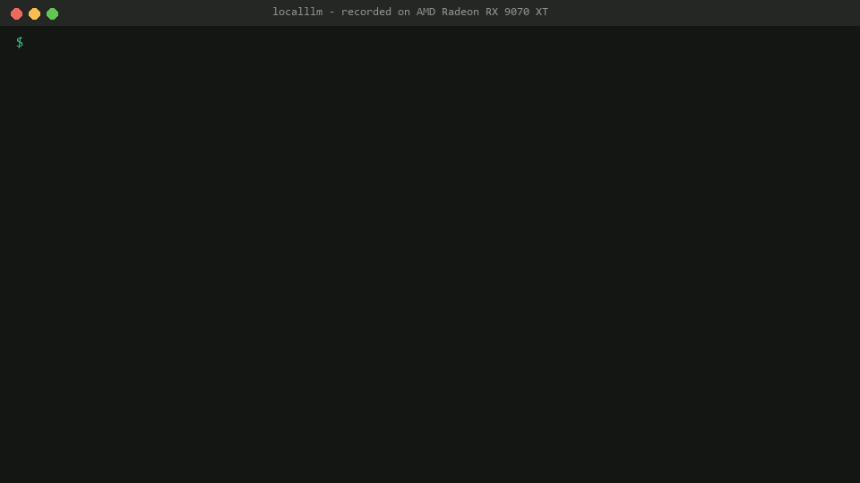

# make-localllm-easier — run the best local LLM your GPU can handle, in one command

[](https://pypi.org/project/make-localllm-easier/)
[](https://github.com/phonology024/make-localllm-easier/actions/workflows/tests.yml)
[](LICENSE)

Read this in: English | [தமிழ்](docs/README.ta.md)

**`localllm` checks your GPU, picks the most accurate AI model that fits it *in your language*, downloads it and starts
a private chat. Offline and free.**



<sub>Recorded from a real run with `tools/record_demo.py`: the text is the commands' own output and the answer streams at the speed llama-server produced it.</sub>

## Install

```
pip install make-localllm-easier
localllm
```

That's it: the first run shows what your PC can run and asks before it downloads the model. No Python? Download the
single `localllm` file for Windows, macOS or Linux (or the AppImage) from the [latest release](https://github.com/phonology024/make-localllm-easier/releases/latest) and run it
from a terminal; `SHA256SUMS` there lets you check it. winget and Homebrew follow
([packaging/README.md](packaging/README.md)).

Or ask your coding agent (Claude Code, Cursor, Codex): paste
`Install localllm: https://raw.githubusercontent.com/phonology024/make-localllm-easier/main/docs/install-for-agents.md`.
It checks your PC first without changing anything, and asks before each install or download
([what it may and may not do](docs/install-for-agents.md)).

## The commands you'll use

```
localllm            # pick, download and start the best model, open the chat page
localllm chat       # chat in the terminal, any language
localllm doctor     # what this GPU can run: model sizes, speed, RAM
localllm serve      # just the API: OpenAI, Anthropic, Ollama and Gemini formats at http://127.0.0.1:8080
```

More: `localllm list` (every measured model), `localllm connect hermes` (point an agent or Obsidian at it),
`localllm eval` (score any server in your language). All commands: `localllm --help`.

**Chat with your files.** In `localllm chat` type `/attach report.pdf` (or a folder); in the `--ui` page, drop a file on
the chat. Each answer comes from the passages that match your question and lists them as sources (file and page),
all on this PC. PDF, DOCX, TXT and MD.

## Why it's different

- **It picks for your GPU.** It reads your card and RAM and only offers models that fit and run fast on them.
- **Measured in your language.** Models are ranked by real exam scores in Thai, Hindi, Arabic, Japanese and 20+ more
  languages, not by English benchmarks alone.
- **Uses less RAM.** llama.cpp tuned op by op: about 4x less system RAM than its defaults, same speed (below).
- **Private.** Your chats never leave your PC, there is no account and no telemetry ([Privacy](#privacy)).

## Less RAM, same speed

Same 30-turn chat, RX 9070 XT, 32 GB RAM:

| model | llama.cpp defaults | `localllm` | speed |
|---|---|---|---|
| Qwen3.8-27B Q3 | 9.30 GB RAM | **2.37 GB** | 35.2 tok/s both |
| gemma-4-26B-A4B QAT | 9.24 GB RAM | **2.21 GB** | ~85 tok/s both |

## Privacy

Chats, files and settings stay on your PC. localllm only goes online to download llama.cpp and models (each checked
against a pinned SHA-256) and for update notices ("localllm 0.8 is out", "a better model for Thai now fits your PC"):
two small requests a day to the project website, nothing about you is sent, and nothing is installed. Turn them off
with `localllm updates off` or `LOCALLLM_NO_UPDATE_CHECK=1`. Cloud routing with your own key is off unless you turn it
on.

## Learn more

[Website and leaderboard](https://phonology024.github.io/make-localllm-easier/) ·
[FAQ](docs/faq.md) ·
[How it works](docs/how-it-works.md) (doctor output, routing, RAM, where it's tested) ·
[APIs and agents](docs/apis.md) ·
[Benchmarks](docs/benchmarks.md) ·
[Research](docs/research.md) ·
[Roadmap](ROADMAP.md) ·
[Stability](docs/stability.md) ·
[Contributing](CONTRIBUTING.md)

Have a GPU we haven't measured? `localllm tune`, `localllm eval --langs en,<yours>`, then `localllm report` opens a
prefilled issue (no names, paths or keys) that adds it to the leaderboard.

## License

MIT. Models keep their own licenses; benchmark data keeps its own (Apache-2.0).
