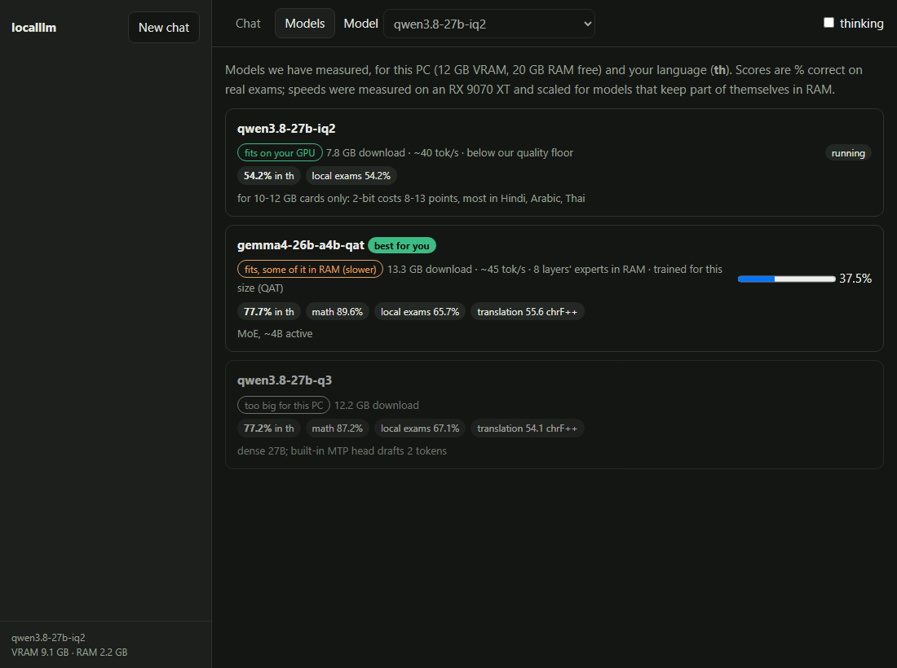

# FAQ

> Moved here from the README on 2026-10-14 so the README fits on one screen. Nothing was removed.

**Which local LLM should I run on my GPU?** Run `localllm doctor`. It lists which model sizes fit your card (4B up to
120B MoE), at which quantization, how fast they should run, the most accurate measured model for your language, and
how much system RAM that model uses (est.).

**Can a 16 GB GPU run a 27B model?** Yes. Qwen3.8-27B at ~3.5 bits (12.2 GB) runs at ~50 tok/s on an RX 9070 XT and
keeps 81.8% on English Global-MMLU-Lite. gemma-4-26B-A4B (13.3 GB) runs at ~85 tok/s with similar accuracy.

**Is a 2-bit quantized model good enough?** Usually not for non-English use: 2-bit costs 8-13 accuracy points, and
Hindi, Arabic and Thai lose the most (13 points).

**Can it use a different local model for each message?** Yes, opt-in: `localllm serve --models auto` routes each
message to the model with the best measured score for its language and task (e.g. Chinese knowledge to Qwen3.8,
Chinese math to gemma-4) and says which model answered. On a 16 GB card a swap costs 4-9 s, so it only switches for a
gain of 3+ points; on 24 GB+ cards both models stay loaded and routing is instant.

**Which local model is better at math?** On MGSM (the same 250 word problems in 11 languages), gemma-4-26B-A4B QAT
scores 96.8 / 89.6 / 88.8 in English / Thai / Chinese vs 94.4 / 87.2 / 84.4 for Qwen3.8-27B Q3, at 1.8x the speed.
Measure any server yourself with `localllm eval --suites math --langs en,de,ja`.

**Which local model translates better?** On FLORES-101 (100 sentences each way, chrF++), gemma-4-26B-A4B QAT beats
Qwen3.8-27B Q3 in Hindi (+4.7), Arabic (+2.9), Japanese (+1.6) and Thai (+1.5); Qwen leads Chinese by 1.4. Try
`localllm eval --suites translate --langs th,ja,sw` (101 languages).

**Does the model still find things deep in a long document?** `localllm serve --profile max`, then
`localllm eval --suites longctx --langs en,th,hi,ar`: secret numbers hidden at 10-90% depth of 8k, 32k and 64k-token
documents written in the language itself (FLORES sentences), one and three at a time. It checks the context `doctor`
promises, not just whether it fits. Catalog numbers are not measured yet (queued in `tools/runner_longctx.json`).

**Why is llama.cpp slow on my AMD (or Intel) GPU on Windows?** If Resizable BAR is off, llama.cpp's Vulkan backend puts
buffers in a 256 MB host-visible heap backed by system RAM and decode drops up to 1.7x. `localllm` sets
`GGML_VK_DISABLE_HOST_VISIBLE_VIDMEM=1` for you ([llama.cpp#27097](https://github.com/ggml-org/llama.cpp/issues/27097)).

**Can it run a 70B-300B model on a 16 GB GPU?** Not by quantization alone without losing quality: a dense 70B is ~14 GB
only at 1.58 bit, and our own 2-bit results already cost 8-13 points. The realistic routes are MoE models with the experts
in system RAM, expert pruning, SSD expert streaming and test-time compute. We are measuring them, none is shipped yet:
[docs/research-big-models.md](research-big-models.md) and ROADMAP 0.9.

**Can I use it in Obsidian?** Yes, through the Copilot for Obsidian plugin: `localllm connect obsidian --path
YOUR_VAULT` makes the local model its default and tells you anything that would still go to a cloud service
([docs/apis.md](apis.md#obsidian)). A harness and our own Obsidian plugin are planned as optional add-ons that never
touch the base install ([docs/addons.md](addons.md)).

**Is there a chat window with saved chats?** `localllm --ui` (or `localllm serve --ui`) opens our own chat page
instead of llama-server's: chats saved as plain files in `~/.localllm/sessions/`, a model picker when you run several
models (`--models auto`), live VRAM/RAM and a warning when the model spills out of the GPU. Nothing is loaded from the
internet. On your network (`--host 0.0.0.0`) the page asks for the key printed in the terminal.

**Which model should I download?** Open the **Models** tab in `localllm --ui`: every model we have measured, marked
*fits on your GPU*, *fits, some of it in RAM (slower)* or *too big for this PC*, with its exam scores in your language,
the expected speed and a download button (checked against its SHA-256). The best one for your PC and language is
marked.

**How much does running an agent locally save?** `localllm savings` counts what this PC answered this month and,
at the cloud prices you enter once, what it would have cost ([docs/apis.md](apis.md#hermes-with-localllm-and-what-it-saves)).

**Can I chat with a local LLM in the terminal?** Yes: `localllm chat`. Answers stream as they're written, the
conversation is remembered, `/save` writes it to a file, `/think` shows the model's reasoning, `/status` shows VRAM, RAM, GPU spill,
context used and the last answer's speed, Ctrl+C stops an answer.

**Can I use it as an Ollama, OpenAI, Anthropic or Gemini replacement?** Yes. One local endpoint at
`http://127.0.0.1:8080` speaks all four APIs, tool / function calling and images (`--vision`) included, so existing apps
and SDKs only need a new base URL. See [docs/apis.md](apis.md).

**Can I use it with Hermes Agent, OpenCode, Claude Code, Codex or Aider?** Yes: `localllm connect hermes` (or
`opencode`, `claude-code`, `codex`, `aider`, `cline`) writes that tool's config to use the local endpoint and backs up
the old one; `--undo` restores it. Or start everything at once: `localllm launch opencode` (server, config, the tool; the old
config comes back when you quit). Start the server with `localllm serve --profile max` so long agent prompts fit. See
[docs/apis.md](apis.md#coding-agents-localllm-connect).

**Can I use my desktop's GPU from my laptop or phone?** Yes: `localllm serve --host 0.0.0.0` listens on your network
and prints an API key once; other devices send it like any API key. It refuses to listen on the network without one.
See [LAN mode](apis.md#use-it-from-another-device-on-your-network-lan-mode).

**Can it fall back to my cloud API key?** Only if you turn it on. Routing is off by default; with your own key in an
environment variable it sends a request to the cloud only when a rule says so (prompt too long, a cloud model asked for
by name, or the local model scores below your floor in that language) and tells you where each answer came from.

**How much RAM does a local LLM need?** With the model fully on the GPU, about 2-2.5 GB of system RAM with `localllm`
(vs ~9 GB growing with llama-server's defaults). `localllm doctor` prints the estimate for your PC.

**Can I post my result?** `localllm report --share` also draws a card (SVG, 1200 x 630) with your GPU, the model
localllm picked, the speed `tune` measured, your score in your language and the RAM it uses, linking to your GPU's
leaderboard page. It comes from the same report as the issue (no names, paths or keys) and is saved next to it in
`~/.localllm/`.

**Something broke. What should I send?** `localllm bugreport` writes one zip with the `doctor` output, versions, the
last lines of the llama-server log and localllm's settings, with API keys, tokens (the LAN key too), your user name
and your home folder taken out. The log can hold text from your recent prompts, so it lists what is inside and asks
first; `--show` prints all of it. Nothing is sent:
attach the zip to a [bug report](https://github.com/phonology024/make-localllm-easier/issues/new?template=bug.yml).

**Does it work offline?** After the first download, yes. Nothing leaves your PC.

**Are the downloads checked?** Yes. llama.cpp comes from the build our numbers were measured on (b11476), and every
file (llama.cpp, models, vision projectors, the task router) is downloaded from a pinned commit and checked against a
SHA-256 stored in the code before it is used. A mismatch deletes the file and stops with the reason.
`LOCALLLM_LLAMA_BUILD=latest` (or `=bNNNNN`) picks another llama.cpp build, checked against the digest GitHub lists for
it.

**Is the chat page in my language?** In English, Thai, Japanese, Chinese, Hindi, Spanish and Arabic (right to left):
it follows your browser's language, then your PC's; `localllm --lang th` (or `LOCALLLM_LANG`) sets it. The first-run
lines, the ready line and the download question in the terminal follow the same setting. The strings are in
`localllm/i18n.py`; fixes from native speakers are very welcome.

**Which languages are measured?** 23 languages on Global-MMLU-Lite, 44 countries' own exams on INCLUDE, plus Thai
(ThaiExam). `localllm eval --langs ...` measures any of them on your hardware.
