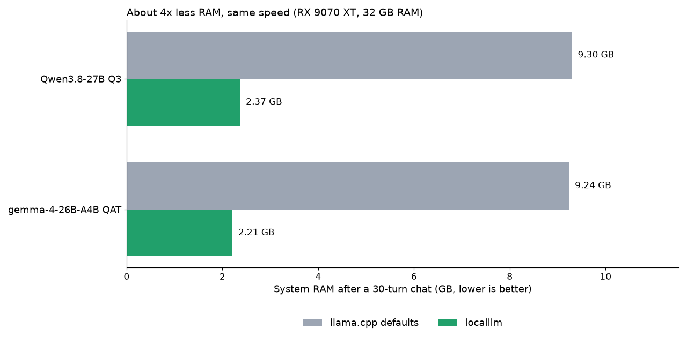

# How it works

> Moved here from the README on 2026-10-14 so the README fits on one screen. Nothing was removed.

`localllm` checks your GPU and RAM, picks the most accurate model we have *measured* for your language that fits your
card, downloads llama.cpp and the model, starts it with settings profiled op by op, and opens the chat page. You also
get an OpenAI-compatible API at `http://127.0.0.1:8080/v1` for any app that speaks it.

## All commands

```
localllm chat       # chat right here in the terminal (Thai, Japanese, any language)
localllm doctor     # what this GPU is good for: model sizes, speed, how much text it can hold
localllm list       # every model we have measured, with scores per language
localllm serve      # API only (OpenAI, Anthropic, Ollama and Gemini formats), no browser
localllm --ui       # our chat page: saved chats, model picker, live VRAM/RAM
localllm savings    # tokens answered locally this month (and $ at the prices you set)
localllm route      # optional: mix in your own cloud key, compare local vs cloud
localllm eval       # score any running server in English + your language
localllm connect hermes   # point an agent (hermes, opencode, claude-code, codex, aider) or Obsidian at it
```

## What `localllm doctor` tells you

```
GPU AMD Radeon RX 9070 XT  15.9 GB  (640 GB/s)    RAM 32 GB    language: th
Tested: Windows/AMD: tested by maintainers

Model sizes for this PC (whole model on the GPU = fast):
  [OK  ] 4B                       Q8 4.2 GB  ~90 tok/s (est.)
  [OK  ] 8B                       Q8 8.5 GB  ~45 tok/s (est.)
  [OK  ] 14B                      Q6 11.5 GB  ~33 tok/s (est.)
  [OK  ] 24-32B                   Q3 13.2 GB  ~29 tok/s (est.)
  [SLOW] 30B MoE (3B active)      Q4 18.0 GB with experts in RAM - works, ~10-25 tok/s
  [NO  ] 70B                      needs ~42.0 GB - too big for this PC
  [NO  ] 120B MoE (10B active)    needs ~72.0 GB - too big for this PC

Best measured model for you: gemma4-26b-a4b-qat  (MoE with ~4B active params: fastest)
What it can do here:
  EN  translated world-knowledge exam   82.2% correct
  EN  grade-school math word problems   96.8% correct
  TH  grade-school math word problems   89.6% correct  <- your language
  TH  real local school/licence exams   65.7% correct  <- your language
  TH  translation to/from English       55.6 chrF++ (0-100)  <- your language
  also measured in ar, es, hi, ja, zh (`localllm list`)
  holds ~78k tokens at once (~130 pages of text) next to the model
  uses ~2.2 GB of system RAM: ~0.3 GB embeddings/CPU-mapped + ~1.0 GB prompt cache + ~0.4 GB ctx checkpoints + ~0.5 GB host (est.)
  leaves ~15 GB of RAM free for other apps (est.)
  with --embeddings: + ~0.2 GB RAM for multilingual-e5-small on the CPU, no VRAM (est.)
  chat with your files (/attach): the same model, + ~0.2 GB RAM if it isn't running yet, + the index of the files attached (nothing indexed yet; ~/.localllm/docs)
  answers at ~90 tok/s
  speed settings not tuned for this PC yet: `localllm tune` measures them once (a few minutes)

Profiles (--profile):
  lean (default)    8k context  ~ 2.2 GB RAM  least memory
  max              78k context  ~ 9.6 GB RAM  long documents, agent sessions
```

Speeds marked *est.* come from your card's memory bandwidth, calibrated on measured runs. Everything else is measured.

**lean or max?** `lean` is the default: an 8k context and caches sized so RAM stays around 2 GB - right for chat and
short questions. `--profile max` spends what the PC has: a context that fills the free VRAM (78k on a 16 GB card) and
a prompt cache of up to a quarter of the RAM, so coding agents and long documents don't re-read their prompt every
turn. Same model, same answers; only memory changes.

**Energy.** `localllm tune` also reads the GPU's board power while it measures (AMD through the driver on Windows or
hwmon on Linux, NVIDIA through `nvidia-smi`), and `doctor` then shows joules per token next to the speed. Only the GPU
board is counted, not the CPU or the power supply. `localllm tune --prefer-energy` keeps a setting that saves more than
15% energy per token while costing less than 5% speed.

## Less RAM than running llama.cpp yourself (0.2)

llama-server's defaults keep a prompt cache of up to 8 GiB plus 32 conversation checkpoints in system RAM, so RAM keeps
growing while you chat. `localllm` sizes both to your PC. The measured numbers for the same 30-turn chat (RX 9070 XT,
32 GB RAM) are the table in the [README](../README.md#less-ram-same-speed), which `tests/test_readme.py` checks against
`tools/footprint_results.jsonl`.



About **4x less RAM, same speed, ~15% less CPU per answer, ~0% CPU while idle.** On cards too small for gemma-4, its
experts can stay in RAM: 45 / 36 / 31 tok/s with 8 / 13 / 18 layers' experts off the GPU (12 / 10 / 8 GB cards).

## Smart routing between local models (experimental, opt-in)

```
localllm serve --models auto          # or --models qwen3.8-27b-q3,gemma4-26b-a4b-qat
```

`--models auto` follows the profile: `lean` (default) routes only between models that fit the GPU whole, so swaps stay
fast and RAM stays small; `--profile max` also takes MoE models that run with some experts in system RAM (one model is
loaded at a time, so each gets the whole GPU and the free RAM).

Each message goes to the model with the best *measured* score for its language and task (math vs general). If all the
models fit in VRAM together (the pair below needs ~27 GB at 8k, so 32 GB cards), they all stay loaded and routing is instant. Otherwise
one model is on the GPU at a time and it only swaps when the other is at least 3 points better, because a swap costs
seconds.
Every answer says which model wrote it and why (`X-Localllm-Model` header; shown under each answer in `localllm chat`).
To keep one model for a whole conversation, type `/stay` in `localllm chat` (or send `X-Localllm-Stay: 1`). After 15
minutes without a message the models are unloaded, so the GPU is free for games and other apps; the next message loads
what it needs (`--idle-unload MIN`, 0 = never). Health checks, model lists and open browser tabs neither keep a model
loaded nor load one: while unloaded, `/health` says so and `/v1/models` lists the pool's models.

The task (general / math / code / translate) comes from keyword rules first, then a small multilingual embedding
classifier (multilingual-e5-small, 126 MB, on the CPU in its own llama-server, ~10 ms per message). Without its files
in `~/.localllm/models/` the keyword rules decide alone and the header says why (`tools/router/README.md`).

What we measured on an RX 9070 XT (16 GB) with 32 GB RAM, and why this is **not the default**:

| | Qwen3.8-27B Q3 | gemma-4-26B-A4B QAT |
|---|---|---|
| Knowledge, Chinese / Spanish / Japanese | **+5.5 / +3.7 / +2.4 pts** | |
| Knowledge, English / Thai / Hindi / Arabic | within 2 pts | within 2 pts, **1.8x faster** |
| Math (MGSM), English / Thai / Chinese | 94.4 / 87.2 / 84.4 | **96.8 / 89.6 / 88.8** |
| Translation (FLORES chrF++), Thai / Chinese / Japanese / Hindi / Arabic | 54.1 / 49.1 / 46.4 / 58.1 / 59.0 | **55.6** / 47.7 / **48.0 / 62.8 / 61.9** |
| Model swap (stop one, load the other) | 8.6 s (4.1 s with the page cache warm and 16 MiB upload buffers) | |

Example: Chinese *knowledge* questions go to Qwen (+5.5); Chinese *math* (+4.4) and translation (within 1.4) stay
on gemma. On a 16 GB card a
second model only pays off for Chinese and Spanish (Japanese +2.4 is inside the benchmark margin), and every
swap costs 4-9 s. Keeping both
models on the card by letting Windows page VRAM made **both** 4-5x slower, so that's not an option. Faster switching
is tracked in [#32](https://github.com/phonology024/make-localllm-easier/issues/32): LoRA adapters on one shared base, or
specialists small enough to sit next to the main model.

## Where it is tested

We measure on one PC: Windows 11, AMD RX 9070 XT, Vulkan. Everything else depends on reports from people who ran
`localllm report` on their own hardware. `localllm doctor` prints the line for your PC. Generated by
`tools/build_leaderboard.py` from [reports/](../reports/):

<!-- platforms:start -->
| | AMD | NVIDIA | Intel | Apple |
|---|---|---|---|---|
| Windows | tested by maintainers | untested | untested | - |
| Linux | untested | untested | untested | - |
| macOS | - | - | - | untested |
<!-- platforms:end -->
